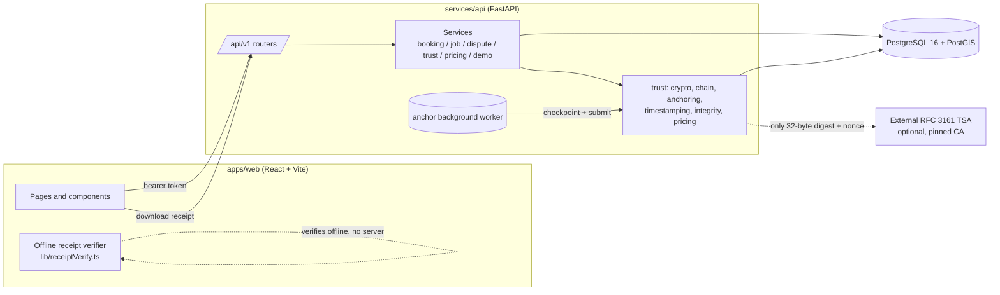
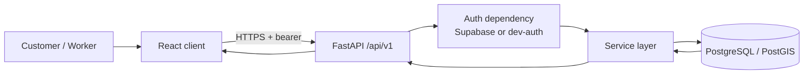
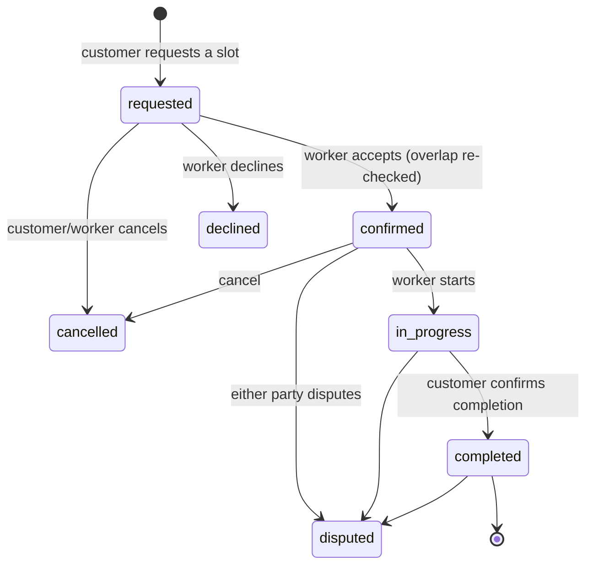
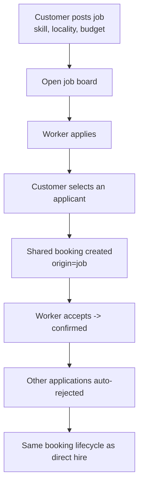
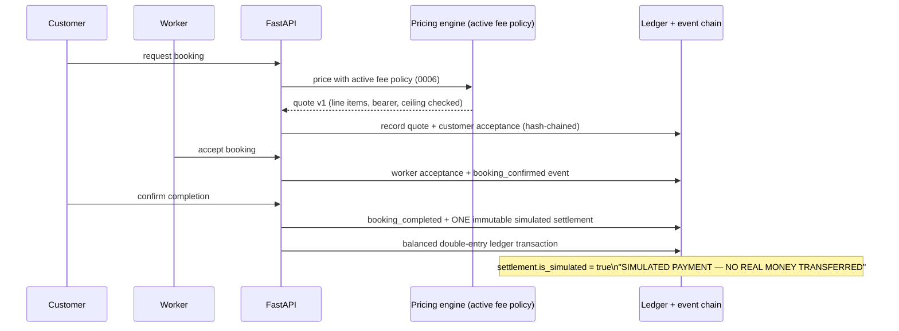
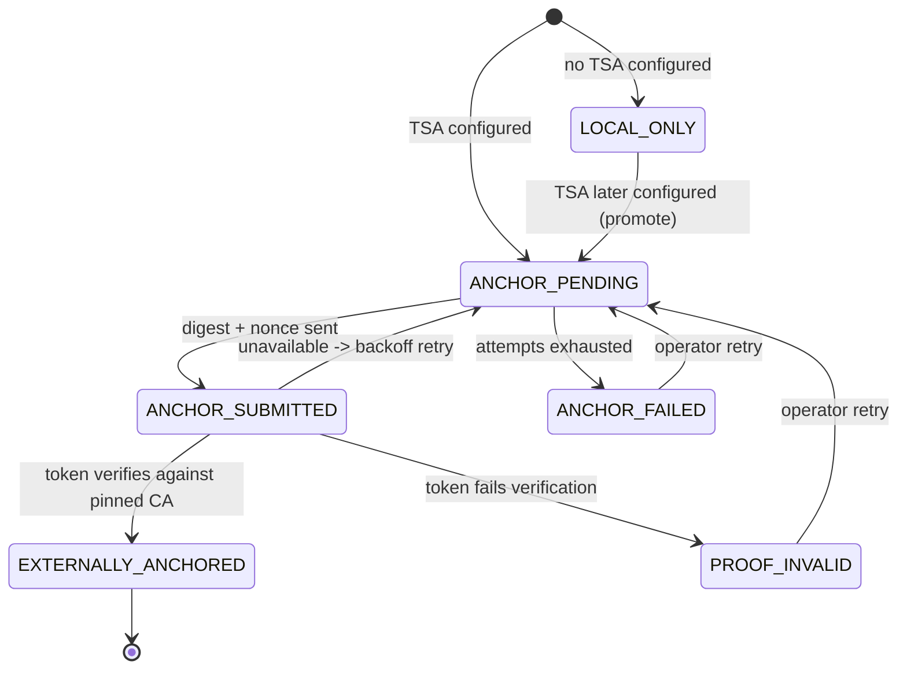

# Architecture

SAHAKAR–SEVA is a small monorepo: a React/TypeScript web client and a versioned FastAPI service over
PostgreSQL/PostGIS, orchestrated for local use with Docker Compose. The API owns all configuration,
persistence, validation and error shaping; schema changes go only through Alembic migrations.

This document describes the **current** runtime. For the present feature inventory see
[`PROJECT_CURRENT_STATE.md`](PROJECT_CURRENT_STATE.md); for byte-level ledger formats see
[`architecture/FINANCIAL_TRANSPARENCY_AND_ANCHORING.md`](architecture/FINANCIAL_TRANSPARENCY_AND_ANCHORING.md).

## System overview

Authentication is verified server-side on every protected request: either a Supabase bearer token
(HS256 shared secret, or server-side `/auth/v1/user` validation) or, for local demos only, a
development identity token. With neither configured the API fails closed with `503
AUTH_NOT_CONFIGURED`.

## Marketplace request path

## Direct hire lifecycle

Discovery uses PostGIS geography radius queries. A worker-side exclusion constraint
(`ex_bookings_worker_no_overlap`, migration `0004`) is the database-level guarantee that a worker can
never hold two overlapping confirmed bookings; `accept` row-locks the worker profile and re-checks
overlap before relying on it.

## Job posting flow

## Financial agreement and simulated settlement

Pricing is never hardcoded. Each booking stores the fee policy id, version, definition hash and line
items of its accepted quote. Changing the active policy affects only new quotes. Charges are recorded
only on completion; cancellations record none; disputes may record a reversal.

## External anchoring (optional)

No network call ever runs inside a database transaction. Checkpoints are an outbox: created inside a
short transaction, submitted to the TSA with no transaction open, then the verified result is recorded
in a second short transaction.

Only a 32-byte SHA-256 checkpoint digest and a random nonce leave the system. `TSA_CA_FILE` is the
**pinned** trust anchor; a certificate inside a TSA response is never trusted on its own. Booking
completion never waits for anchoring.

This is **not** a blockchain and the system is **not** decentralized. Independent assurance comes from
(a) an RFC 3161 timestamp issued by a third party over a checkpoint digest, and (b) receipts that
participants hold and can re-verify offline — not from distributed consensus.

## Trust/evidence verification

```mermaid
flowchart LR
  subgraph Evidence
    EV[Event chain\nSHA-256, domain-separated, RFC 8785]
    CP[Merkle checkpoints\nRFC 9162 inclusion proofs]
    LD[Double-entry ledger\ndebits == credits]
  end
  EV --> V1[integrity.verify_records\nserver-side]
  CP --> V1
  LD --> V1
  R[Downloaded receipt JSON] --> V2[scripts/verify_receipt.py\noffline, no server code]
  R2[Earlier receipt copy] --> V2
  V2 --> OUT{verified / local-only / failed}
```

## Deployment (local)

Docker Compose runs three services: `db` (PostGIS, host port `55432`), `api` (FastAPI on `8000`,
applies migrations on start), and `web` (Vite dev server on `5173`). `scripts/dev_up.sh` pins the
local database credentials for that command, applies migrations, seeds the taxonomy and activates the
labelled illustrative fee policy, then health-checks the API. See the root `README.md` quick start.
