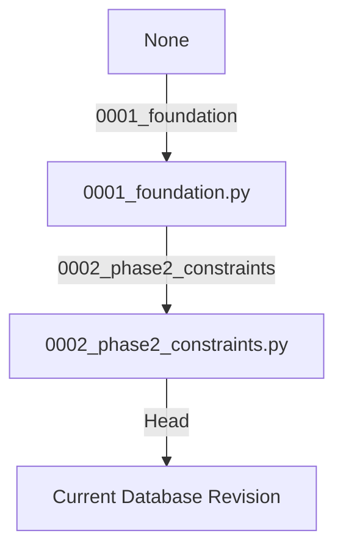

# SAHAKAR–SEVA — Phase 2 Database & Migration Audit

**Audit Date:** 2026-10-27  
**Database Architect & Auditor:** Principal Database Architect & Systems Auditor  
**Lead Developer:** Shresth (Database Architecture, Models, Migrations, Repositories)  
**Database Engine:** PostgreSQL 16 + PostGIS 3.4 (Verified live via `SELECT PostGIS_Version()`)  
**ORM:** SQLAlchemy 2.0  
**Migration Tool:** Alembic  

---

## 1. Migration Graph Analysis

### Revision Inventory:
1. **`0001_foundation`** (`services/api/alembic/versions/0001_foundation.py`):
   - **Parent Revision:** `None` (Base migration)
   - **Operations:**
     - Enables PostGIS extension: `CREATE EXTENSION IF NOT EXISTS postgis`
     - Creates tables: `users`, `worker_profiles`, `organizations`, `organization_memberships`
     - Creates indexes: `ix_users_email`, `ix_worker_profiles_user_id`, `ix_organization_memberships_user_id`
     - Creates unique constraints: `users_external_auth_id_key`, `users_email_key`, `worker_profiles_user_id_key`, `uq_organization_membership` (`organization_id`, `user_id`)
     - Creates foreign keys with `ON DELETE CASCADE`:
       - `worker_profiles.user_id` -> `users.id`
       - `organization_memberships.organization_id` -> `organizations.id`
       - `organization_memberships.user_id` -> `users.id`
   - **Downgrade Safety:** Fully reversible (`op.drop_table`, `op.drop_index`, `op.execute("DROP EXTENSION IF EXISTS postgis")`).
   - **Execution Status:** **PASS** (Applied cleanly to live PostgreSQL database).

2. **`0002_phase2_constraints`** (`services/api/alembic/versions/0002_phase2_constraints.py`):
   - **Parent Revision:** `0001_foundation`
   - **Operations:**
     - Adds check constraint `ck_worker_profiles_onboarding_status`:  
       `onboarding_status IN ('draft', 'pending_review', 'approved', 'restricted')`
     - Adds check constraint `ck_organizations_organization_type`:  
       `organization_type IN ('business', 'cooperative')`
     - Adds check constraint `ck_organization_memberships_role`:  
       `membership_role IN ('owner', 'admin', 'member')`
   - **Downgrade Safety:** Fully reversible (`op.drop_constraint(..., type_="check")`).
   - **Execution Status:** **PASS** (Applied cleanly; verified by `SELECT version_num FROM alembic_version`).

---

## 2. Table-by-Table Schema Verification

### 2.1 Table: `users`
Represents the unified global identity for every human participant on the platform.

| Field | DB Type | Nullable | Constraints & Indexes | SQLAlchemy Model Field | Pydantic Schema Mapping |
|---|---|---|---|---|---|
| `id` | `uuid` (v4) | NOT NULL | PRIMARY KEY | `Mapped[UUID]` (`default=uuid4`) | `UserRead.id` (`UUID`) |
| `external_auth_id` | `varchar(255)` | NULL | UNIQUE (`users_external_auth_id_key`) | `Mapped[str \| None]` (`unique=True`) | Excluded from public read schema (Safe) |
| `display_name` | `varchar(120)` | NOT NULL | None | `Mapped[str]` (`String(120)`) | `UserRead.display_name`, `UserUpdate.display_name` (2–80 chars) |
| `email` | `varchar(320)` | NOT NULL | UNIQUE (`users_email_key`), Index `ix_users_email` | `Mapped[str]` (`String(320)`, `unique=True`) | `UserRead.email` (valid RFC 5322 email) |
| `created_at` | `timestamptz` | NOT NULL | DEFAULT `now()` | `Mapped[datetime]` (`server_default=func.now()`) | `UserRead.created_at` |
| `updated_at` | `timestamptz` | NOT NULL | DEFAULT `now()` | `Mapped[datetime]` (`server_default=func.now()`, `onupdate=func.now()`) | `UserRead.updated_at` |

**Verification Assessment:**
- Dual-role foundation: Every user is an individual customer by default.
- Account-takeover protection: `external_auth_id` and `email` are both individually unique.
- Relationships: `worker_profile` (1-to-0..1 via `uselist=False`), `organization_memberships` (1-to-many).

---

### 2.2 Table: `worker_profiles`
Represents the provider/worker extension of a user.

| Field | DB Type | Nullable | Constraints & Indexes | SQLAlchemy Model Field | Pydantic Schema Mapping |
|---|---|---|---|---|---|
| `id` | `uuid` (v4) | NOT NULL | PRIMARY KEY | `Mapped[UUID]` (`default=uuid4`) | `WorkerProfileRead.id` |
| `user_id` | `uuid` | NOT NULL | UNIQUE, FK `users.id` ON DELETE CASCADE, Index `ix_worker_profiles_user_id` | `Mapped[UUID]` (`ForeignKey("users.id", ondelete="CASCADE")`, `unique=True`) | `WorkerProfileRead.user_id` |
| `display_name` | `varchar(120)` | NOT NULL | None | `Mapped[str]` (`String(120)`) | `WorkerProfileRead.display_name` (2–80 chars) |
| `bio` | `text` | NULL | None | `Mapped[str \| None]` (`Text`) | `WorkerProfileRead.bio` (max 500 chars) |
| `onboarding_status`| `varchar(40)` | NOT NULL | DEFAULT `'draft'`, CHECK `ck_worker_profiles_onboarding_status` | `Mapped[str]` (`String(40)`, `default="draft"`) | `WorkerProfileRead.onboarding_status` (`Literal[...]`) |
| `created_at` | `timestamptz` | NOT NULL | DEFAULT `now()` | `Mapped[datetime]` (`server_default=func.now()`) | `WorkerProfileRead.created_at` |
| `updated_at` | `timestamptz` | NOT NULL | DEFAULT `now()` | `Mapped[datetime]` (`server_default=func.now()`, `onupdate=func.now()`) | `WorkerProfileRead.updated_at` |

**Verification Assessment:**
- 1-to-1 constraint enforced at DB level (`UNIQUE ("user_id")`).
- Status check constraint protects state machine: only `'draft'`, `'pending_review'`, `'approved'`, `'restricted'` are allowed.
- Self-approval blocked: Pydantic schemas forbid client modifications to `onboarding_status`.

---

### 2.3 Table: `organizations`
Represents legal or operating entities (businesses and cooperatives).

| Field | DB Type | Nullable | Constraints & Indexes | SQLAlchemy Model Field | Pydantic Schema Mapping |
|---|---|---|---|---|---|
| `id` | `uuid` (v4) | NOT NULL | PRIMARY KEY | `Mapped[UUID]` (`default=uuid4`) | `OrganizationWithMyRole.id` |
| `name` | `varchar(160)` | NOT NULL | None | `Mapped[str]` (`String(160)`) | `OrganizationWithMyRole.name` (2–120 chars) |
| `organization_type`| `varchar(20)` | NOT NULL | CHECK `ck_organizations_organization_type` | `Mapped[str]` (`String(20)`) | `organization_type` (`'business'` \| `'cooperative'`) |
| `created_at` | `timestamptz` | NOT NULL | DEFAULT `now()` | `Mapped[datetime]` (`server_default=func.now()`) | `OrganizationWithMyRole.created_at` |
| `updated_at` | `timestamptz` | NOT NULL | DEFAULT `now()` | `Mapped[datetime]` (`server_default=func.now()`, `onupdate=func.now()`) | `OrganizationWithMyRole.updated_at` |

**Verification Assessment:**
- Distinct legal entities supported from foundation: cooperative vs business.
- Name length allows up to 160 characters in DB, API enforces 2–120 characters.

---

### 2.4 Table: `organization_memberships`
Maps human users to organizations with assigned administrative/operational roles.

| Field | DB Type | Nullable | Constraints & Indexes | SQLAlchemy Model Field | Pydantic Schema Mapping |
|---|---|---|---|---|---|
| `id` | `uuid` (v4) | NOT NULL | PRIMARY KEY | `Mapped[UUID]` (`default=uuid4`) | Internal ID |
| `organization_id` | `uuid` | NOT NULL | FK `organizations.id` ON DELETE CASCADE | `Mapped[UUID]` | Scoped organization |
| `user_id` | `uuid` | NOT NULL | FK `users.id` ON DELETE CASCADE, Index `ix_organization_memberships_user_id` | `Mapped[UUID]` | Member identity |
| `membership_role` | `varchar(40)` | NOT NULL | CHECK `ck_organization_memberships_role` | `Mapped[str]` (`String(40)`) | `my_membership_role` (`'owner'` \| `'admin'` \| `'member'`) |
| `created_at` | `timestamptz` | NOT NULL | DEFAULT `now()` | `Mapped[datetime]` (`server_default=func.now()`) | Internal timestamp |

**Verification Assessment:**
- Compound uniqueness: `UNIQUE ("organization_id", "user_id")` prevents double-membership in an organization.
- Check constraint enforces permitted roles: `'owner'`, `'admin'`, `'member'`.
- Cascade deletion ensures clean referential integrity when an organization or user is deleted.

---

## 3. PostGIS Extension Verification

- **Migration Statement:** `CREATE EXTENSION IF NOT EXISTS postgis` in `0001_foundation.py`.
- **Live Database Inspection:** Executed `SELECT PostGIS_Version()` -> Output: `3.4 USE_GEOS=1 USE_PROJ=1 USE_STATS=1`.
- **Roadmap Readiness:** Geospatial columns (e.g. worker home coordinates, job site coordinates, service radii) can be introduced via ordinary Alembic migrations in Phase 3 without database re-initialization.

---

## 4. Model vs. Schema vs. Database Discrepancy Findings

| Item | Database (Postgres) | SQLAlchemy Model | Pydantic Schema | Severity | Assessment |
|---|---|---|---|---|---|
| `users.display_name` | `varchar(120)` | `String(120)` | `min_length=2, max_length=80` | None (Safe) | Pydantic validation is stricter than DB column width, preventing DB truncation errors. |
| `worker_profiles.display_name` | `varchar(120)` | `String(120)` | `min_length=2, max_length=80` | None (Safe) | Complies with OpenAPI contract. |
| `organizations.name` | `varchar(160)` | `String(160)` | `min_length=2, max_length=120` | None (Safe) | Complies with OpenAPI contract. |
| `worker_profiles.bio` | `text` | `Text` | `max_length=500` | None (Safe) | Text allows flexible length while Pydantic restricts user input to 500 chars. |
| Cascade Deletes | `ON DELETE CASCADE` | `ondelete="CASCADE"` | N/A | None (Safe) | Correctly cleans child records. |

---

## 5. Repository Handshake & Data Access Layer Audit

### Findings:
1. **Shresth's Implementation:**
   - Shresth cleanly implemented all agreed functions in:
     - `app.repositories.user_repository`
     - `app.repositories.worker_repository`
     - `app.repositories.organization_repository`
     - `app.repositories.exceptions` (`UserNotFoundError`, `WorkerProfileExistsError`, `WorkerProfileNotFoundError`, `IdentityConflictError`)
   - All repository functions are 100% covered by passing database integration tests in `services/api/tests/db/`.
2. **Architectural Gap (Repository Bypass):**
   - Priyanshu's backend services (`UserService`, `WorkerService`, `OrganizationService`) do NOT invoke Shresth's repository functions.
   - Instead, the services execute raw SQLAlchemy queries directly.
   - **Consequence:** Two parallel data-access implementations exist. Changes to repository logic will not affect live API behavior unless services are refactored to call the repositories as agreed in `OWNERSHIP_MAP.md`.
3. **Legacy Repository File:**
   - `services/api/app/repositories/user.py` contains class-based `UserRepository`, `WorkerProfileRepository`, and `OrganizationRepository`. This file is superseded by the function-based repositories and represents dead/confusing code.
